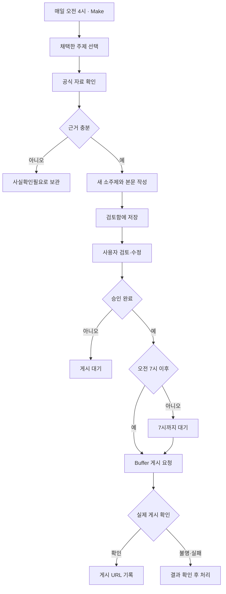

# 전체 설계도

일정·연결·자동 점검은 구현할 동작이며 실제 실행 중이라는 의미가 아닙니다.

| 구분 | 항목 | 설계 내용 |
| --- | --- | --- |
| 상태 | 설계 문서 | 이 탭은 구현할 전체 설계도입니다. Make·OpenAI API·Buffer 연결 및 예약 실행 활성화를 완료했다는 의미가 아닙니다. |
| 목표 | 운영 방식 | 매일 한국 시간 오전 4시 초안 1개 작성 → 시트에서 사용자 검토·수정·승인 → 오전 7시 이후 승인된 글만 Threads 게시. 하루 최대 1개. |
| 연결 | 사용 서비스 | Google Sheets(주제·출처·초안·승인·이력) → Make(일정·조건·실행 상태) → OpenAI API(공식 자료 검색·글 작성) → Buffer(Threads 게시) → Threads. |
| 연결 | 계정 연결 | Buffer에 Threads 계정 연결. Make에 Google Sheets·OpenAI API·Buffer 연결. API 키는 Make 연결 관리에 보관하고 시트에는 쓰지 않습니다. |
| 콘텐츠 | 주제 순서 | 첨부 자료의 분야 순서 1~9를 하루 한 분야씩 순환하는 제안입니다. 분야 안에서는 채택·사용 중인 세부 주제를 순서대로 선택합니다. |
| 콘텐츠 | 순위 해석 | 첨부 순위는 릴스 조회수 참고자료입니다. 초기 편성 순서로 활용하고 Threads 반응을 따로 기록합니다. 조회수 합계만으로 분야별 효과를 확정하지 않습니다. |
| 주제 1 | 지원금 · 생활·복지 | 예시: 사장이라고 생활·복지 지원 대상에서 무조건 빠질까? 사업가·가구의 실제 대상 조건과 지역·신청 시기 확인. |
| 주제 2 | 자영업 운영·마케팅 | 예시: 매출은 늘었는데 통장엔 돈이 없지? / 견적서는 빨리 보내는데 계약은 왜 안 될까? |
| 주제 3 | 세금·절세 | 예시: 절세하는 사업가? 탈세하는 사업가? / 법인카드로 긁었으니 다 비용 아닌가? |
| 주제 4 | 기타 · AI·업무 개선 | 예시: 중소기업 AI 활용, 우리 회사는 어디쯤일까? / AI 구독료만 늘고 야근은 그대로라면? |
| 주제 5 | 지원금 · 사업자·소상공인 | 예시: 정부지원금, 공짜 돈인 줄 알았어? 자부담·지원 대상·정산 의무·중복 수혜 조건 확인. |
| 주제 6 | 노무·고용 | 예시: 좋은 사장이라면 근로계약서는 대충 써도 될까? / 사람이 부족한 걸까 일이 꼬인 걸까? |
| 주제 7 | 정책자금 | 예시: 정책자금, 금리만 낮으면 좋은 선택일까? 보증료·상환·자격·접수 상태 확인. |
| 주제 8 | 창업·사업자 세팅 | 예시: 법인으로 바꾸면 세금이 무조건 줄까? / 동업 지분 50 대 50, 공평한데 왜 불안하지? |
| 주제 9 | 법인·대표 재무 | 예시: 법인 정관, 설립할 때 받은 파일 그대로야? / 대표 월급 vs 배당, 뭐가 더 남을까? |
| 순환 | 다음 회차 작성 | 9번 다음에는 1번으로 돌아갑니다. 같은 분야와 주제라도 대상·업종·실수·준비 서류·점검 질문을 바꾸어 새 소주제로 작성합니다. 기존 문장을 바꿔 쓰는 방식은 피합니다. |
| 순환 | 후보 없는 분야 | 해당 분야에 채택·사용 중인 세부 주제가 없으면 다음 준비된 분야로 넘어갑니다. 승인되지 않은 새 주제를 임의로 활성화하지 않습니다. |
| A · 오전 4시 | 1. 오늘 슬롯 확보 | 계정+한국 날짜로 고유한 초안 키를 만듭니다. 당일 초안이 이미 있으면 중복 작성하지 않습니다. |
| A · 오전 4시 | 2. 주제와 이력 읽기 | 마지막 선택 분야 다음 분야에서 채택·사용 중인 주제를 고릅니다. 최근 30개 글과 같은 주제의 최근 글을 읽습니다. |
| A · 오전 4시 | 3. 공식 자료 조사 | Make HTTP 모듈에서 OpenAI Responses API의 web_search 도구를 사용합니다. 분야별 공식 도메인을 우선 또는 허용 목록으로 설정합니다. 검색 호출 여부와 실제 출처 URL·확인일을 기록합니다. |
| A · 오전 4시 | 4. 근거 정리 | 세금·법률·지원사업은 적용 연도·대상·지역·기간·금액·예외를 원문과 대조합니다. 출처를 못 찾거나 모호한 내용은 사실확인필요로 두고 자동 게시 대상에서 제외합니다. |
| A · 오전 4시 | 5. 본문 작성 | 확인된 사실과 주제·독자·최근 이력을 별도 작성 호출에 전달합니다. 250~400자 내외의 한국어 본문과 새 소주제를 만듭니다. 게시 전 실제 플랫폼 길이 계산을 별도로 검증합니다. |
| A · 오전 4시 | 6. 검토함 저장 | 주제·소주제·본문·근거 링크·확인일·주의 조건을 저장합니다. 승인 상태=검토대기, 처리 상태=미전송. 초안 저장에 성공한 후에만 분야·주제 순환 상태를 갱신합니다. |
| 사용자 검토 | 승인 방법 | 검토함에서 본문·근거 링크·적용 조건을 읽고 직접 수정합니다. 사실 확인이 끝난 글만 승인으로 바꿉니다. 보류·검토대기는 게시하지 않습니다. 주제 채택과 게시글 승인은 별개입니다. |
| 사용자 검토 | 수정과 승인 | 본문을 고칠 때는 검토대기로 돌린 뒤 수정하고 재승인합니다. 현재 시트에는 본문 수정 시 승인을 자동 해제하는 코드가 없습니다. 자동 해제가 필요하면 Sheets Apps Script onEdit을 추가합니다. |
| B · 오전 7시 이후 | 1. 승인 확인 | 한국 시간 07:00~23:55에 5분 간격으로 확인합니다. Make 요금제의 최소 실행 간격을 확인합니다. 7시 전 승인한 글은 첫 실행 때, 이후 승인한 글은 다음 실행 때 처리합니다. |
| B · 오전 7시 이후 | 2. 게시 필터 | 오늘 게시 예정일 AND 승인 상태=승인 AND 사실 확인 완료 AND 처리 상태=미전송 AND Buffer 접수 ID 없음. 동일 계정의 하루 1개 제한과 실행 동시성 1을 적용합니다. |
| B · 오전 7시 이후 | 3. 최종 본문 전달 | 보내기 직전 행을 다시 읽고 승인·날짜·상태·최종 본문을 확인합니다. 처리중으로 바꾼 후 승인한 본문 그대로 Buffer의 Threads 계정에 즉시 게시 요청합니다. |
| B · 오전 7시 이후 | 4. 결과 기록 | Buffer 접수 ID와 전달 시각을 저장하고 전달완료로 기록합니다. 접수만으로 실제 게시 성공으로 기록하지 않습니다. Buffer 결과 또는 실제 게시 URL로 최종 확인합니다. |
| 예외 | 미승인·전날 글 | 승인이 없으면 기다립니다. 당일 마감 후 미승인 글은 보관하며 다음 날 임의로 게시하지 않습니다. 재사용 시 날짜를 지정하고 다시 검토·승인합니다. |
| 예외 | 중복·실패 | 날짜별 고유 키와 Buffer 접수 ID로 중복을 막습니다. 접수 여부가 불확실한 오류는 결과확인필요로 기록하고 자동 재전송하지 않습니다. 실패 시 다음 글을 임의로 대체 게시하지 않습니다. |
| 출처 | 공식 자료 예시 | 지원·정책: 기업마당(bizinfo.go.kr), 소상공인시장진흥공단(semas.or.kr), 중소벤처기업부(mss.go.kr), 복지로(bokjiro.go.kr). 세무: 국세청(nts.go.kr). 법령: 국가법령정보센터(law.go.kr). 노무: 고용노동부(moel.go.kr). |
| 말투 | Threads 문체 | 친근한 반말. 첫 1~2줄은 사업가가 자기 상황을 떠올릴 질문·반전. 1~2문장마다 줄바꿈. 쉬운 설명과 오늘 점검할 행동 하나. 과장·공포·무조건 유리하다는 표현·가짜 경험·성과 수치 금지. |
| 시트 | 기존 탭 | 사용법 / 주제목록 / 검토함 / Make설정은 기존 상태를 유지했습니다. 현재 주제 30개는 검토대기·사용안함 상태입니다. |
| 시트 | 구현 시 추가할 필드 | 주제목록: 분야 ID·주제 고유 ID. 검토함: 공식 출처 URL·출처 확인일·적용 조건·사실 확인 상태. 현재 이 탭에 적은 추가 필드는 아직 생성하지 않았습니다. |
| 반응 확인 | 초기 운영 | 우선 Buffer에서 조회수·좋아요·답글·재게시·인용 등을 확인하고 제공되는 지표만 기록합니다. 주 1회 분야·소주제별로 비교합니다. 반응 확인 자동 수집은 다음 단계로 둡니다. |
| 비용 | 요금 구성 | Make 작업량, OpenAI 글 작성·웹 검색 사용량, Buffer 요금제에 따라 결정됩니다. ChatGPT 구독과 OpenAI API 요금은 별도입니다. 5분 간격 승인 확인 비용도 포함합니다. |
| 구축 순서 | 실행 절차 | 주제 채택·분야 배치 → 시트 필드 보완 → Buffer↔Threads 연결 → Make↔Sheets/OpenAI/Buffer 연결 → A 초안 생성 구성 → B 승인 게시 구성 → 테스트 → 예약 활성화. |
| 테스트 | 활성화 전 확인 | 미승인 글 차단 / 7시 전·후 승인 동작 / 하루 1개·중복 방지 / 오래된 공고 차단 / 접수 불명 오류 시 중지 / 실제 승인한 테스트 글 1개 게시와 URL 확인. |
| 설계일 | 2026-11-12 | 한국 시간 기준. 현재 문서는 설계 제안이며 실제 자동화의 실행 상태를 나타내지 않습니다. |
