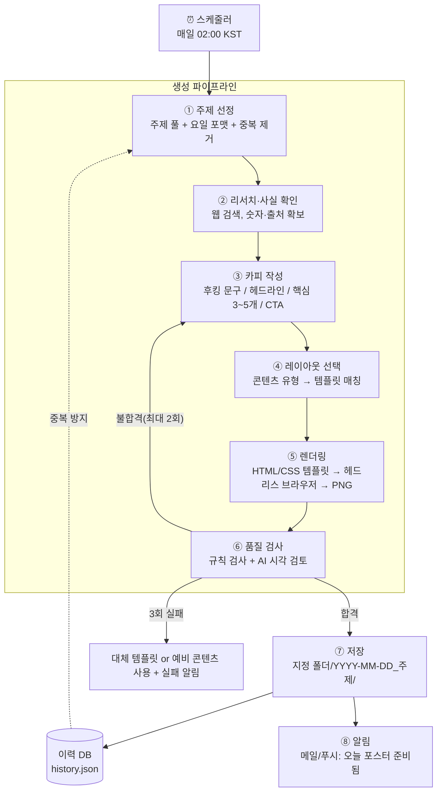

# 인스타그램 원페이지 인포그래픽 자동 생성 — 전체 설계서

작성일: 2026-11-10 · 기준 시간대: `Asia/Seoul`

> 매일 새벽 2시에 정해진 주제 영역에서 오늘의 소주제를 뽑고, 후킹 문구와 핵심 정보를 담은 1장짜리 인포그래픽 포스터(PNG)와 캡션을 만들어 지정 폴더에 저장한다. 이 문서는 설계 명세이며, 아직 구현된 것은 없다.

---

## 1. 목표와 범위

### 하루 산출물 (1세트)

| 파일 | 내용 |
|---|---|
| `poster.png` | 1080×1350(4:5) 인포그래픽 1장. 인스타 피드에서 가장 크게 보이는 비율 |
| `caption.txt` | 본문 캡션 + 해시태그 20~30개 + 저장/공유 유도 문구 |
| `meta.json` | 주제, 후킹 문구, 사용 템플릿, 출처, 품질 점수, 생성 시각 |
| `sources.md` | 사실 확인에 쓴 출처 링크 |

### 필수 기능

- 매일 02:00(KST) 자동 실행, 사람이 개입하지 않아도 완료
- 같은 주제 영역 안에서 **겹치지 않는** 소주제 선정 (최근 90일 이력 비교)
- 후킹 문구 + "1초에 읽히는" 핵심 정보 구성
- 한글이 깨지지 않는 고품질 렌더링
- 지정 폴더(구글 드라이브 또는 PC 폴더)에 날짜별 저장
- 실패 시 재시도 → 대체 템플릿 → 그래도 실패하면 알림
- **인스타 업로드는 자동으로 하지 않음** (1차 버전). 사람이 아침에 확인 후 올린다.

---

## 2. 전체 구조도



---

## 3. 단계별 상세 설계

### ① 주제 선정 (Topic Engine)

주제가 "비슷하지만 매일 다르게" 나오도록 **3층 구조**로 관리한다.

```
대주제(채널 정체성)   예: 돈 관리 / 건강 습관 / 심리학 / AI 활용 …
 └ 카테고리(8~15개)  예: 절약, 투자 기초, 세금, 신용점수 …
    └ 소주제(매일 1개) 예: "통장 쪼개기 4단계"
```

- **주제 풀(`config/topics.yaml`)**: 카테고리별 시드 키워드를 미리 정의. AI가 여기서 확장해 소주제를 생성한다.
- **요일별 포맷 로테이션**: 같은 대주제라도 형식이 바뀌면 지루하지 않다.

  | 요일 | 포맷 | 예시 |
  |---|---|---|
  | 월 | 숫자 충격형 | "직장인 73%가 모르는 ○○" |
  | 화 | 비교형 (A vs B) | "적금 vs ETF, 10년 뒤 차이" |
  | 수 | 체크리스트형 | "지금 당장 해지할 구독 5가지" |
  | 목 | 단계/프로세스형 | "신용점수 올리는 4단계" |
  | 금 | 오해 vs 진실형 | "다들 틀리는 ○○ 상식 3가지" |
  | 토 | 랭킹/TOP N | "가성비 최고 ○○ TOP 5" |
  | 일 | 한 장 요약/치트시트 | "○○ 한 장 정리" |

- **중복 방지**: 최근 90일 이력의 소주제·후킹 문구와 비교해 유사하면 재선정 (텍스트 유사도 또는 AI 판정).
- **시즌성 가중치**: 연말정산(1월), 명절, 신학기 등 날짜 캘린더(`config/calendar.yaml`)에 맞는 주제를 우선.
- **선택적 트렌드 반영**: 웹 검색으로 최근 이슈를 확인해 관련 소주제를 가산점.

### ② 리서치·사실 확인

- AI에 웹 검색 도구를 붙여 **수치·통계·출처**를 확보한다. 인포그래픽은 숫자 하나가 신뢰를 좌우한다.
- 규칙: 수치에는 반드시 출처 URL 1개 이상. 출처를 못 찾은 수치는 사용 금지 → 정성적 문장으로 대체.
- 건강·금융·법률 주제는 단정 표현을 피하고 하단에 "참고용 정보" 문구를 자동 삽입.

### ③ 카피 작성 — "1초 후킹" 설계

포스터 위 텍스트는 **3단 위계**로만 구성한다. 이게 1초 안에 시선을 잡는 핵심이다.

| 층 | 역할 | 길이 제한 | 시선 머무는 시간 |
|---|---|---|---|
| ① 후킹 문구 | 스크롤을 멈추게 함 | 15자 이내, 최대 2줄 | 0~1초 |
| ② 핵심 정보 3~5개 | 저장하고 싶게 만듦 | 항목당 20자 + 보조 1줄 | 1~5초 |
| ③ CTA/출처 | 저장·팔로우 유도 | 1줄 | 마지막 |

**후킹 문구 공식 (AI 프롬프트에 그대로 제공)**

1. 숫자 충격형 — "하루 10분이 1년에 60시간"
2. 손실 회피형 — "모르면 매년 30만원 손해"
3. 반전형 — "아침 공복 커피, 사실은…"
4. 질문형 — "당신의 통장은 몇 개인가요?"
5. 비밀/내부자형 — "은행원은 절대 안 하는 3가지"
6. 대비형 — "부자 vs 보통 사람의 주말"

**생성 방식**: 후킹 문구 후보 5개를 만들고, AI가 스스로 채점(호기심·명확성·길이·과장 여부)해 1등을 선택. 후보와 점수는 `meta.json`에 남겨 나중에 실제 반응(좋아요·저장 수)과 비교해 공식을 개선한다.

**출력은 정해진 JSON 스키마로 받는다** (구조화 출력):

```json
{
  "hook": "모르면 매년 30만원 손해",
  "subhook": "연말정산 전 꼭 챙길 공제 5가지",
  "format": "checklist",
  "items": [
    {"icon": "medical", "title": "의료비 공제", "desc": "총급여 3% 초과분부터", "highlight": "15%"}
  ],
  "cta": "저장해두고 12월에 꺼내 보세요",
  "sources": ["https://..."],
  "caption": "…",
  "hashtags": ["#연말정산", "…"]
}
```

### ④ 레이아웃 선택

콘텐츠 유형(`format`)에 맞는 템플릿을 자동 매칭한다. 템플릿은 7~10종으로 시작.

```
templates/
  number_shock.html   큰 숫자 1개 + 설명 3줄
  versus.html         좌우 2단 비교
  checklist.html      체크 아이콘 리스트
  steps.html          1→2→3→4 흐름 화살표
  myth_fact.html      ❌ 오해 / ⭕ 진실 표
  ranking.html        1~5위 막대/메달
  cheatsheet.html     2×3 그리드 요약
```

**"1초 시선" 디자인 규칙 (템플릿에 내장)**

- 초점은 하나: 화면에서 가장 큰 요소(후킹 문구 또는 큰 숫자)가 면적의 25% 이상
- 글자 수 총합 80자 이내 (캡션에서 상세 설명)
- 고대비: 배경과 글자 명도 대비 4.5:1 이상
- 강조색은 1가지만, 브랜드 컬러 고정 → 피드에서 "그 계정" 인식
- 상단 1/3에 후킹 문구 (피드 썸네일·프로필 그리드에서 잘리지 않는 영역)
- 시선 흐름: 위→아래 Z 또는 I 패턴, 아이콘으로 항목 구분
- 하단 고정: 계정 핸들, 출처 한 줄, 시리즈 번호(예: `#037`)

### ⑤ 렌더링

| 방식 | 장점 | 단점 | 판단 |
|---|---|---|---|
| **HTML/CSS 템플릿 → 헤드리스 브라우저 스크린샷** | 한글 완벽, 레이아웃 정확, 매번 일관된 브랜드 | 템플릿 제작 필요 | ✅ **기본 방식** |
| AI 이미지 생성 모델이 포스터 전체 생성 | 화려함 | 한글 오탈자·숫자 오류 위험, 일관성 낮음 | ❌ 본문엔 사용 안 함 |
| 혼합: 배경/일러스트만 AI 생성 + 글자는 HTML | 시각적 풍부함 + 정확성 | 비용·시간 증가 | ⭕ 2단계 옵션 |

- 도구: Python + Jinja2(템플릿에 데이터 주입) + Playwright(Chromium으로 1080×1350, 2배율 렌더 후 축소)
- 폰트: Pretendard / 본고딕 등 상업 이용 가능한 한글 폰트를 저장소에 포함
- 아이콘: 오픈 라이선스 아이콘 세트(SVG)를 로컬에 보관

### ⑥ 품질 검사 (QA)

**자동 규칙 검사 (코드)**
- 텍스트가 박스 밖으로 넘치지 않는지 (DOM에서 overflow 측정)
- 글자 수·줄 수 제한, 대비 비율
- 수치마다 출처 존재 여부
- 금지어·과장 표현 목록(`config/banned_words.txt`) 검사

**AI 시각 검토**
- 렌더링된 PNG를 AI에게 보여주고 "1초 안에 핵심이 읽히는가 / 오탈자 / 어색한 문장 / 사실 오류"를 10점 척도로 채점
- 7점 미만이면 지적 사항을 붙여 ③ 카피 단계로 되돌림 (최대 2회)

### ⑦ 저장

```
<지정폴더>/
  2026/11/
    2026-11-11_연말정산공제5가지/
      poster.png
      caption.txt
      meta.json
      sources.md
```

- **구글 드라이브 폴더 권장**: 클라우드에서 만들어 드라이브에 올리면 폰·PC 어디서든 바로 보이고, 폰에서 인스타에 바로 올리기 쉽다.
- PC 로컬 폴더를 원하면: 드라이브 데스크톱 앱 동기화 폴더를 지정 폴더로 쓰면 PC가 꺼져 있어도 생성은 되고, 켜질 때 내려받아진다.

### ⑧ 알림

- 완료 시: "오늘의 포스터: [후킹 문구]" + 썸네일 + 폴더 링크를 메일 또는 푸시로 발송
- 실패 시: 실패 단계와 사유, 예비 콘텐츠 사용 여부를 알림

---

## 4. 실행 위치(스케줄러) 선택

새벽 2시에 **PC가 꺼져 있어도** 돌아가야 하므로 클라우드 실행을 권장한다.

| 옵션 | 방식 | 장점 | 단점 |
|---|---|---|---|
| **A. GitHub Actions (권장)** | 이 저장소에 워크플로 추가, `cron: "0 17 * * *"` (UTC 17시 = KST 02시) | 무료 한도 내 운영, 코드·이력이 저장소에 남음, PC 불필요 | cron이 수 분~수십 분 늦게 시작될 수 있음 (새벽이라 무관) |
| B. Claude 예약 작업 | Claude Code 클라우드의 예약 작업이 매일 새 세션을 띄워 같은 파이프라인 실행 | 설정이 가장 간단, 구글 드라이브 커넥터 활용 | 실행마다 결과가 조금씩 달라질 수 있어 스크립트 방식보다 덜 결정적 |
| C. 내 PC 작업 스케줄러 / cron | Windows 작업 스케줄러로 스크립트 실행 | 로컬 폴더 직접 저장 | PC가 켜져 있어야 함 |

> 추천: **A + 구글 드라이브 저장**. 비밀값(AI API 키, 드라이브 서비스 계정 키)은 GitHub Secrets에 보관.

---

## 5. 기술 스택

| 영역 | 선택 |
|---|---|
| 언어 | Python 3.12 |
| AI | Anthropic Claude API (`anthropic` SDK). 기본 모델 `claude-opus-5-5`, 웹 검색 서버 도구로 리서치, 구조화 출력으로 JSON 고정, 이미지 입력으로 시각 QA |
| 템플릿 | Jinja2 + HTML/CSS |
| 렌더링 | Playwright (Chromium) |
| 이미지 후처리 | Pillow (리사이즈, 용량 최적화) |
| 저장 | Google Drive API (서비스 계정) 또는 로컬 파일 |
| 스케줄 | GitHub Actions cron |
| 알림 | Gmail API 또는 텔레그램/디스코드 웹훅 |
| 이력 | `data/history.json` (저장소에 커밋) → 규모 커지면 SQLite |

예상 비용: 하루 AI 호출 4~6회(주제·리서치·카피·QA) 수준으로 월 수천 원대. 실제 비용은 첫 1주 사용량을 측정해 확정한다.

---

## 6. 저장소 구조

```
pickus/
  .github/workflows/daily_poster.yml   # 매일 02:00 KST 실행
  config/
    channel.yaml        # 대주제, 톤, 타깃 독자, 브랜드 컬러, 계정 핸들
    topics.yaml         # 카테고리·시드 키워드
    calendar.yaml       # 시즌 이벤트
    weekday_formats.yaml
    banned_words.txt
  prompts/
    topic.md  research.md  copy.md  qa.md
  templates/            # 레이아웃 HTML/CSS 7~10종
  assets/fonts/  assets/icons/
  src/
    main.py             # 파이프라인 오케스트레이션
    topic_engine.py
    researcher.py
    copywriter.py
    layout.py
    renderer.py
    qa.py
    storage.py          # 드라이브/로컬 저장
    notifier.py
  data/history.json
  backup_contents/      # 실패 대비 예비 콘텐츠 7개
  tests/
```

---

## 7. 장애 대응

| 상황 | 대응 |
|---|---|
| AI 호출 실패/지연 | 지수 백오프 재시도 3회 |
| QA 3회 불합격 | 가장 높은 점수의 버전 저장 + `NEEDS_REVIEW` 표시 |
| 렌더링 실패 | 가장 단순한 템플릿(`cheatsheet`)으로 대체 |
| 전체 실패 | `backup_contents/`에서 미사용 예비 콘텐츠 1개 사용 + 실패 알림 |
| 같은 날 중복 실행 | 오늘 날짜 폴더가 이미 있으면 건너뜀 (멱등성) |

---

## 8. 단계별 로드맵

| 단계 | 기간 | 내용 |
|---|---|---|
| 0. 기획 확정 | 1일 | 대주제, 타깃, 톤, 브랜드 컬러, 저장 폴더 결정 |
| 1. MVP | 3~5일 | 주제 선정 + 카피 + 템플릿 3종 + 로컬 PNG 저장, 수동 실행 |
| 2. 자동화 | 2일 | GitHub Actions 02:00 스케줄 + 드라이브 저장 + 알림 |
| 3. 품질 | 3일 | 리서치·출처, 시각 QA 루프, 템플릿 7종 확장 |
| 4. 성장 | 이후 | 인스타 인사이트(저장·공유 수) 수집 → 잘 된 후킹 공식·포맷 가중치 자동 조정, 캐러셀(여러 장) 확장, 승인 후 자동 업로드(인스타 비즈니스 계정 + Graph API) |

---

## 9. 시작 전에 정해야 할 것

1. **대주제** — 채널이 다룰 한 가지 영역 (예: 재테크, 건강, 심리, AI 활용)
2. **타깃 독자** — 예: 20~30대 사회초년생
3. **브랜드** — 메인/강조 컬러 2개, 계정 핸들, 말투(반말/존댓말)
4. **저장 위치** — 구글 드라이브 폴더 또는 PC 폴더 경로
5. **알림 수단** — 메일 / 텔레그램 / 없음
6. **검수 방식** — 매일 사람이 확인 후 업로드(권장) vs 추후 자동 업로드
