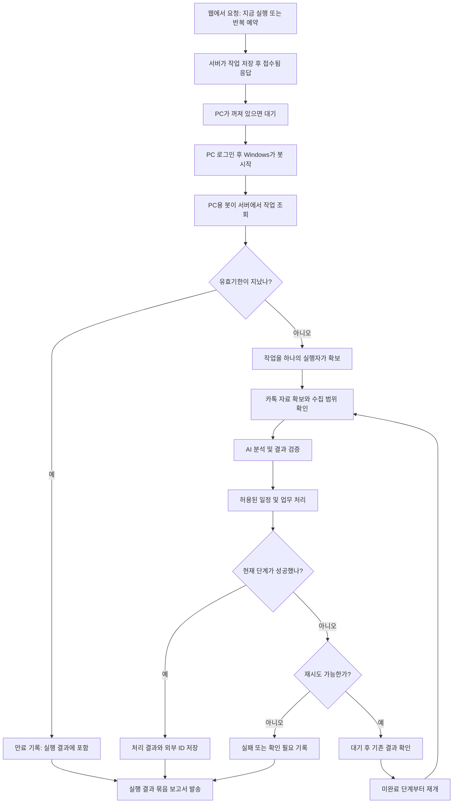

# 카카오톡 업무 자동화 봇 — 코딩 지시서

작성일: 2026-10-24 · 기준 시간대: `Asia/Seoul`

> 이 문서를 구현 담당 AI 또는 개발자에게 전달하고 아래 요구사항에 따라 프로젝트를 구현한다. 이 문서는 제작 명세이며, 봇이나 외부 계정 연결이 이미 만들어졌다는 뜻은 아니다.

## 1. 만들 프로그램

사용자는 웹에서 지금 실행하거나 반복 실행을 설정한다. 인터넷 서버는 할 일을 보관한다. 사용자 PC가 켜지고 준비되면 PC용 봇이 작업을 가져와 카카오톡 자료를 확보한다. 확보된 내용을 AI가 분석하고, 허용된 일정·업무 처리를 수행한 뒤 지정 이메일로 결과를 보낸다.

평소에는 매번 실행 명령이나 승인을 요구하지 않는다. 처음 설정한 계정·대상·자동 처리 범위 안에서 실행하고, 자료 부족·모호한 요청·연결 문제 등 사람이 필요한 경우만 알린다.

### 용어를 쉽게 설명하기

| 이름 | 뜻 | 실행 장소 |
|---|---|---|
| 웹 화면 | 지금 실행, 반복 주기, 종료일, 결과를 보는 화면 | 브라우저 |
| 서버 | 할 일과 처리 기록을 보관하고 인터넷 작업을 처리하는 프로그램 | 호스팅한 서버 |
| PC용 봇 또는 워커 | 서버에서 할 일을 가져와 PC 작업을 수행하는 프로그램 | 사용자 Windows PC |
| API | 프로그램끼리 요청과 결과를 주고받는 통로 | 인터넷 연결 |
| 처리 기록 | 어디까지 했고 무엇이 만들어졌는지 보관한 기록 | 서버 DB 및 PC의 보조 기록 |

Codex 등 코딩 도구로 이 프로젝트를 제작할 수 있다. 코딩 도구의 웹 채팅 자체를 상시 운영 서버로 가정하지 않는다. 제작한 프로그램을 실제 실행 환경에 설치·배포한다. MCP는 선택 사항이며 첫 버전의 필수 의존성으로 만들지 않는다.

## 2. 확정할 목표와 범위

### 필수 기능

- 웹의 `지금 실행` 버튼으로 작업을 접수한다.
- 반복 주기와 종료일을 설정한다.
- PC가 꺼져 있어도 작업을 영구 보관한다.
- Windows 로그인 후 PC용 봇을 자동 시작한다.
- 마지막 처리 이후 확보 가능한 자료와 미완료 작업을 확인한다.
- 대화에서 새 업무, 일정, 마감, 변경, 취소를 추출한다.
- 설정된 범위의 일정·업무를 등록하거나 수정한다.
- 실행 결과를 묶어 지정 이메일로 보고한다.
- 중간 종료·통신 장애·재부팅 후 복구한다.
- 이미 성공한 작업을 불필요하게 반복하지 않는다.
- 실제 등록·발송을 하지 않는 미리보기 모드를 제공한다.

### 첫 버전의 운영 조건

- Windows PC 1대, 사용자 1명, 서버 1개로 시작한다.
- 웹 서버의 데이터베이스를 작업 상태의 기준으로 삼는다.
- 화면 조작이 필요한 작업은 로그인한 사용자 환경과 앱 준비 상태를 확인한다.
- PC가 꺼져 있는 동안 PC 작업은 대기한다. 이미 서버에 필요한 자료가 확보된 단계는 PC 없이 진행할 수 있다.
- 원격 명령만으로 꺼진 PC를 켜는 기능은 첫 버전에 포함하지 않는다.
- 지원할 자동 업무는 명시된 기능 목록으로 제한한다. 임의 셸 명령 실행 기능을 외부에 제공하지 않는다.

## 3. 전체 흐름



그림의 재개 화살표는 전체 작업을 처음부터 다시 실행한다는 뜻이 아니다. 실제 구현에서는 수집·분석·각 외부 처리·보고 단계별 기록을 조회하여 미완료 단계만 실행한다. 수집과 분석 단계의 오류에도 같은 복구 규칙을 적용한다.

## 4. 가장 먼저 검증할 것: 카카오톡 입력

### 4.1 입력 방식의 제약

일반 개인 카카오톡 채팅방의 기존 대화를 가져오는 공개 공식 API를 전제하지 않는다. 카카오 메시지 발송 API와 대화 수집 기능을 혼동하지 않는다.

다음 두 가지 입력 방식을 별도 모듈로 분리한다.

| 방식 | 구현 내용 | 완료라고 주장할 수 있는 범위 |
|---|---|---|
| 파일 입력 | 지정 폴더의 카톡 대화 내보내기 TXT를 읽음 | 파일 공급 이후의 자동 처리 |
| 화면 수집 | 사용자 PC에서 검증한 방법으로 대상 방의 대화를 내보내거나 확보 | 실제 검증에 성공한 방·앱·로그인 조건에서의 자동 수집 |

화면 수집은 무조건 가능하다고 가정하지 않는다. 별도의 가능성 검증을 먼저 수행한다. 암호화된 내부 DB 해독이나 비공개 프로토콜 우회는 첫 버전의 구현 범위에서 제외한다.

### 4.2 파일 입력 구현

- 폴더 경로, 허용 파일 형식, 대상 방을 설정한다.
- 시작할 때 전체 대상 폴더를 확인하고, 이후 주기적으로 새 자료를 확인한다. 파일 변경 알림에만 의존하지 않는다.
- 파일 저장이 끝나기 전에 읽지 않도록 안정화 확인 또는 재읽기를 구현한다.
- 인코딩·날짜·여러 줄 메시지를 처리한다. 지원하는 내보내기 형식을 명시한다.
- 파일마다 원본 식별값, 해시, 수집 시각, 파싱 결과, 수집 범위를 기록한다.
- 같은 파일이 다른 이름으로 들어오거나, 이전 대화를 포함한 전체 파일이 다시 들어와도 중복 처리하지 않도록 검증한다.
- 마지막 시각 하나만으로 처리 대상을 판단하지 않는다. 같은 시각의 여러 메시지와 겹치는 수집 구간을 처리한다.
- 메시지 본문 해시만으로 모든 동일 문구를 한 건으로 합치지 않는다. 방·발언자·시각·문맥 및 동일 메시지의 반복 출현을 고려한다.
- 신뢰할 수 있는 메시지 ID가 없어서 동일성 판단이 불확실하면 자동 처리하지 말고 확인 필요로 기록한다.

### 4.3 화면 수집 검증

검증 항목: 로그인 상태, 앱 실행 상태, 화면 잠금, 대상 방 식별, 내보내기 동작, 저장 완료, PC 종료 기간의 자료 확보 범위, 앱 변경 시 실패 감지.

- 단순 고정 좌표 클릭에만 의존하는 수집기를 안정적인 완성품이라고 표현하지 않는다.
- 수집 실패를 `새 대화 없음`으로 처리하지 않는다.
- 새 파일이 없거나 확보 범위가 불분명하면 `자료 대기` 또는 `확인 필요`로 표시한다.
- 과거 내보내기 파일만으로 최신 대화까지 처리했다고 보고하지 않는다.
- 사용자에게 원본 대화의 어느 부분이 AI 서비스로 전송되는지 설명한다.

## 5. 구성 프로그램과 권장 초기 구조

Python 기반의 소규모 개인용 프로젝트로 구성한다. 버전은 구현 시 호환성을 확인하고 의존성 파일에 고정한다.

| 구성요소 | 구현 방향 |
|---|---|
| 웹/API 서버 | FastAPI 등으로 인증된 작업 접수·조회·결과 API 제공 |
| 서버 실행 담당 | DB에 저장된 예약·분석·외부 처리·보고 작업을 실행하는 별도 루프 또는 프로세스 |
| 서버 DB | 초기에는 SQLite 가능. 서버 한 인스턴스·작은 작업량으로 범위 명시 |
| PC용 봇 | Python 프로그램. 시작·인증·작업 확보·수집·상태 전송·복구 담당 |
| PC 보조 DB | SQLite. 수집 결과와 아직 서버에 전송하지 못한 결과를 보관 |
| AI 분석 | 제공자별 교체 가능한 연결 모듈. 테스트용 가짜 제공자 포함 |
| 일정/업무 연결 | 서비스별 연결 모듈. 첫 실제 서비스부터 단계적으로 구현 |
| 이메일 연결 | Gmail API 등 선택한 한 가지 방식부터 구현 |
| 자동 시작 | Windows 작업 스케줄러 등록·해제 스크립트 |

서버와 PC의 SQLite 파일을 서로 동기화하거나 공용 드라이브에 올려 동시에 수정하지 않는다. 서버 DB는 작업 상태의 기준이고 PC DB는 수집·복구를 위한 보조 기록이다.

예시 폴더 구조:

```text
project/
  README.md
  pyproject.toml
  .env.example
  .gitignore
  config.example.yaml
  server/
    api/
    web/
    scheduler/
    processor/
    storage/
  agent/
    cli.py
    worker.py
    collectors/
      exported_txt.py
      desktop_collector.py
    storage/
  integrations/
    ai/
    calendar/
    tasks/
    mail/
    fake/
  common/
    schemas/
    config/
  scripts/
    register_agent_task.ps1
    unregister_agent_task.ps1
    backup.ps1
  tests/
    fixtures/
  docs/
    setup.md
    operations.md
    source-collection-check.md
```

`desktop_collector.py`가 아직 구현되지 않았다면 미지원이라고 명시한다. 빈 성공 결과를 반환하는 가짜 구현으로 감추지 않는다.

## 6. 서버 API와 연결

> 아래 경로는 이 프로젝트에서 만들 API의 예시이며, OpenAI 또는 카카오의 API 주소가 아니다.

| API 예시 | 역할 |
|---|---|
| `POST /jobs` | 작업을 DB에 저장한 뒤 작업 ID와 접수 상태 반환 |
| `GET /jobs/{id}` | 진행 상태·단계별 결과·보고 상태 조회 |
| `POST /jobs/{id}/cancel` | 미실행 작업 또는 남은 단계 취소 요청 |
| `POST /schedules` | 반복 주기·종료일·작업 설정 저장 |
| `PATCH /schedules/{id}` | 예약 변경·일시 중지 |
| `POST /agents/heartbeat` | PC용 봇 연결 및 준비 상태 보고 |
| `POST /agents/claim` | 처리 가능한 로컬 단계를 원자적으로 확보 |
| `POST /agent-tasks/{id}/heartbeat` | 작업 점유 갱신 |
| `POST /agent-tasks/{id}/result` | 결과를 중복 안전하게 전송 |
| `POST /agent-tasks/{id}/error` | 실패 단계·오류 종류·복구 가능성 기록 |

필수 조건:

- 내 PC가 서버로 접속하는 방식으로 시작한다. PC의 외부 공개 포트를 요구하지 않는다.
- 운영 연결은 HTTPS와 인증을 사용한다.
- PC별 자격증명은 해당 PC에 배정된 작업만 처리할 수 있도록 제한한다.
- 웹 관리자 인증과 PC용 봇 인증을 구분한다.
- `접수됨`은 작업이 영구 저장된 후에만 반환한다. 접수와 완료를 구분한다.
- 동일 요청 키로 접수가 재시도되면 같은 작업 ID를 반환한다.
- 결과 업로드가 재시도되어도 중복 분석·등록 작업을 만들지 않는다.
- 첨부 자료의 크기·형식·저장 경로를 검증한다. 외부 입력 경로를 그대로 사용하지 않는다.
- 서버 재시작 시 DB에 저장된 대기·재시도·진행 중 작업을 점검하고 복구한다.
- 메모리의 타이머나 웹 요청의 일회성 백그라운드 작업만으로 예약과 처리를 유지하지 않는다.

## 7. 작업과 상태 저장

### 7.1 최소 데이터

- PC: ID, 마지막 연결 시각, 로그인/수집 준비 상태, 버전.
- 예약: 주기, 시간대, 반복 종료 시각, 활성 상태, 다음 실행 시각.
- 작업: ID, 요청 키, 생성 시각, 대상 PC, 유효기한, 실행 모드, 상태.
- 단계: 수집/분석/각 외부 처리/보고의 상태, 시도 횟수, 다음 재시도 시각.
- 수집: 입력 자료 ID, 원본 범위, 파싱 상태, 메시지 식별 정보.
- 업무: 근거 메시지, 담당자, 기한, 변경/취소 관계, 처리 결정.
- 외부 처리: 동작 키, 전송 전 기록, 외부 ID, 응답 및 검증 결과.
- 보고서: 실행 묶음 ID, 고정된 수신자, 내용 버전, 발송 상태, 외부 발송 ID.

### 7.2 작업 상태

`queued`, `running`, `waiting_input`, `retry_wait`, `needs_review`, `completed`, `failed`, `expired`, `canceled`를 기본으로 사용한다.

PC 연결 여부는 PC 상태로 따로 관리한다. PC가 꺼져 있다는 이유만으로 즉시 작업을 실패로 바꾸지 않는다. 웹에는 이해하기 쉬운 문구로 `PC 연결 대기`, `대화 자료 대기`, `처리 중`, `확인 필요` 등을 표시한다.

보고 상태는 업무 처리 상태와 분리한다. 업무 처리가 끝났어도 보고서 발송이 남아 있을 수 있다. 일부만 완료된 경우 완료·실패·보류 내역을 함께 표시한다.

### 7.3 작업 점유와 재부팅 복구

- 조회와 `처리중` 표시를 별개로 수행하지 않는다. 하나의 트랜잭션/조건부 갱신으로 작업을 확보한다.
- 점유 토큰과 유효시간을 발급하고 실행 중 주기적으로 갱신한다.
- 진행 신호가 끊긴 작업은 점유 만료 후 결과를 대조하고 복구한다.
- 오래된 점유 토큰의 결과 제출과 상태 변경을 거절한다.
- 점유 제어가 외부 서비스의 중복 실행까지 완전히 막는다고 가정하지 않는다. 별도의 외부 동작 중복 방지가 필요하다.
- PC에는 하나의 봇만 실행되도록 운영체제 잠금 또는 복구 가능한 락을 사용한다.
- 재부팅 후 남은 오래된 락 때문에 영구 정지하지 않게 한다.

## 8. 일정·업무 해석과 자동 처리 규칙

### AI 출력에 포함할 정보

대화방, 근거 메시지 식별값, 발언자, 발언 시각, 작업 종류, 제목, 담당자, 시작·종료·마감 시각, 시간대, 확정/제안/취소 구분, 기존 업무와의 관계, 불확실한 항목을 구조화한다.

- `내일`, `다음 주`는 발언 시각과 해당 시간대를 기준으로 해석한다.
- 제안, 질문, 인용, 가정, 확정된 지시를 구별한다.
- 담당자가 불명확하면 사용자의 업무로 임의 배정하지 않는다.
- 새로 확보된 구간의 변경·취소를 함께 반영하고 최종 상태를 결정한 뒤 실행한다.
- 일정 변경은 저장한 외부 일정 ID를 찾아 수정한다.
- 취소·완료된 업무를 다시 생성하지 않도록 연결 관계를 보존한다.
- 이미 마감이 지난 업무는 설정된 처리 규칙에 따라 보류하거나 보고한다.
- 관련 업무의 의미를 이해하는 데 필요한 앞선 문맥을 포함한다.

JSON 형식 검증과 내용 검증을 분리한다. 스키마를 통과해도 날짜·담당자·근거가 틀릴 수 있다. AI의 자체 확신도만을 자동 실행 기준으로 사용하지 않는다.

### 자동 실행 범위

- 사용자가 초기 설정에서 허용한 일정 등록·수정, 업무 기록, 정해진 보고서 발송은 반복 승인 없이 수행할 수 있게 한다.
- 모호한 날짜, 상충하는 요청, 대상 업무 식별 실패 등은 `확인 필요`로 보류한다.
- 추가 업무 기능은 명시적인 허용 목록으로 제공한다. 예: 정해진 템플릿의 문서 생성.
- 결제, 임의 파일 삭제, 새 외부 수신자에게 임의 발송 등은 기본 자동 처리 목록에 포함하지 않는다.
- 대화 원문을 프로그램 운영 지시로 실행하지 않는다. 대화 속 문장으로 수신자·권한·종료일·실행 코드를 바꾸지 않는다.

## 9. 중복 방지와 실패 복구

### 외부 동작별 처리

1. 실행 전에 업무 ID·동작 종류·변경 버전으로 고유 동작 키를 만든다.
2. 이미 완료한 같은 동작이 있는지 확인한다.
3. 동작 의도를 먼저 저장한다.
4. 서비스가 지원하면 중복 방지 키 또는 지정 가능한 외부 ID를 사용한다.
5. 응답과 외부 ID를 저장하고 결과를 검증한다.
6. 응답을 받지 못한 경우 기존 외부 결과를 확인하고 재실행을 판단한다.

외부 서비스가 중복 방지나 결과 조회를 충분히 지원하지 않으면 정확히 한 번 실행을 보장한다고 주장하지 않는다. 결과를 판단할 수 없는 동작은 확인 필요로 보류할 수 있게 한다.

### 오류 구분

| 오류 | 대응 |
|---|---|
| 일시적 네트워크 오류·일부 서버 오류 | 제한적 재시도 |
| 호출량 제한 | 서비스 안내 대기시간과 한도를 준수 |
| 인증 만료 | 지원되는 갱신 시도, 해결되지 않으면 재연결 알림 |
| 권한 부족·잘못된 설정 | 무한 재시도하지 않고 원인 보고 |
| 자료 없음·수집 범위 불명 | 자료 대기 또는 확인 필요 |
| 잘못된 AI 출력 | 제한적으로 재생성하거나 확인 필요 |
| 외부 작업 결과 불명 | 기존 결과 조회 후 재시도 여부 결정 |

- 요청별 타임아웃과 전체 단계의 최대 소요시간을 둔다.
- 재시도 간격 증가와 작은 무작위 지연을 사용한다.
- 시도 횟수와 총 재시도 시간을 제한하고, 다음 시도 시각을 DB에 저장한다.
- PC와 서버가 같은 단계의 재시도를 각각 중복 관리하지 않도록 단계별 책임을 정한다.
- 완료한 단계는 유지하고 미완료 단계만 복구한다.

## 10. 반복 일정·종료일·수동 실행

다음 세 값을 구분한다.

| 값 | 의미 |
|---|---|
| `repeat_until` | 새 반복 작업을 만드는 마지막 시각 |
| `expires_at` | 특정 작업의 외부 동작을 허용하는 마지막 시각 |
| `due_at` | 대화에서 추출한 업무 자체의 마감 |

- 저장은 시간대가 명확한 시각으로 하고 화면에서는 한국 시간으로 표시한다.
- 종료일을 날짜로 입력하면 한국 시간 기준 포함 범위를 명시한다. 내부 비교는 명확한 종료 경계를 사용한다.
- 서버는 `repeat_until` 이후 새 반복 작업을 만들지 않는다.
- 외부 동작 전에는 `expires_at`과 취소 여부를 다시 확인한다.
- 이미 외부로 전송된 요청을 종료일 도달만으로 되돌릴 수 있다고 보장하지 않는다.
- 만료·취소 때 이미 처리한 부분이 있으면 그대로 기록하고 보고한다.
- 보고서 발송에는 별도 보존·재시도 기간을 둔다. 업무 유효기한이 지났어도 만료 사실은 보고할 수 있다.
- PC가 꺼진 동안의 반복 요청은 같은 대상·같은 처리 범위에 대해 합쳐 처리할 수 있게 한다. 밀린 횟수만큼 같은 등록을 반복하지 않는다.
- 서버가 중단됐다 복구된 경우에도 예약 기준과 처리 기록으로 누락을 판정한다.
- 수동 실행과 예약 실행은 같은 접수·중복 방지·종료일 검증을 거친다.
- 반복 종료 후 수동 실행은 새 요청의 유효기한을 명시하여 접수할 수 있게 한다. 만료된 작업을 몰래 재활성화하지 않는다.

## 11. 보고서·알림

### 보고서 내용

- 작업/실행 묶음 ID와 처리 시각.
- 수집한 방과 자료 범위, 최신성 및 누락 가능성.
- 새 업무, 일정 등록·변경·취소, 처리한 업무.
- 실패·보류·확인 필요 항목과 근거.
- 사람이 해야 할 조치와 다음 실행 예정 시각.

여러 항목을 하나의 실행 묶음으로 처리하면 보고서 한 통으로 묶는다. 이메일 발송 자체는 독립된 작업으로 저장한다. 발송만 실패했을 때 일정 등록·업무 수행을 다시 실행하지 않는다.

메일 서비스가 요청을 수락한 상태와 실제 받은편지함에 도착한 상태를 구분한다. 발송 응답이 유실된 경우 확인 없이 무한 재발송하지 않는다.

### 알림 조건

- 실행 실패, 인증 재연결 필요, 수집 중단, 지정 대기시간 초과, 예정된 성공 기록 누락을 구분한다.
- PC가 꺼져 있을 것으로 허용한 시간에는 반복 경고하지 않는다.
- 같은 미해결 문제의 알림을 묶거나 빈도를 제한한다.
- 로컬 봇이 꺼진 사실은 서버에서 감시한다.
- 서버 자체 중단은 서버 밖의 상태 확인 수단이 감지할 수 있도록 상태 확인 URL과 운영 방법을 제공한다.
- 이메일 연결 자체가 실패할 수 있으므로 웹에도 문제를 남기고, 필요하면 별도 알림 경로를 설정할 수 있게 한다.

## 12. 설정·인증·개인정보

다음 설정을 사용자 화면 또는 설정 파일에서 관리한다.

| 설정 | 예시 또는 요구사항 |
|---|---|
| 시간대 | `Asia/Seoul` |
| 서버 주소와 PC ID | 실제 설치 환경 값 |
| 대화 입력 방식 | `exported_txt` 또는 검증된 `desktop` |
| 대상 방·입력 폴더 | 명시적 허용 목록 |
| 반복 주기·종료일·작업 유효시간 | 서로 구분 |
| AI 제공자·모델 | 실제 선택 전에는 가짜 연결로 시험 |
| 일정·업무 저장 서비스 | 서비스와 대상 계정/저장소 ID |
| 보고서 수신자 | 초기 설정한 목록. 대화에서 자동 변경 금지 |
| 실행 모드 | 기본 `dry_run` |
| 재시도·대기 알림 기준 | 횟수·시간·알림 간격 |
| AI 비용·처리량 한도 | 일별 또는 실행별 상한 |
| 원본·분석·로그 보관 기간 | 불필요한 장기 보관 방지 |

- 실제 키와 토큰을 소스·Git·로그·보고서에 포함하지 않는다.
- `.env.example`에는 이름과 예시만 넣는다. `.env`와 토큰 파일은 Git에서 제외한다.
- `.env`와 `.gitignore`가 암호화를 제공한다고 설명하지 않는다. 실제 자격증명은 운영체제 보안 저장소 또는 제한된 권한의 비밀 저장소에 보관한다.
- 서버용 AI·메일·캘린더 자격증명과 PC용 봇 자격증명을 구분한다.
- 토큰 자동 갱신, 취소·만료, 재연결 흐름을 구현한다. 최초 로그인 성공만으로 운영 인증이 완료됐다고 판단하지 않는다.
- Google OAuth의 테스트 게시 상태 등 장기 운영에 영향을 주는 조건을 구현 시 공식 문서로 확인한다.
- 원본 TXT는 기본적으로 로컬에 보관한다. AI 분석을 서버에서 수행하면 필요한 메시지 내용은 외부로 전송된다는 사실을 명시한다.
- 방 제외, 전송 최소화, 로그 마스킹, 보관 기한에 따른 삭제를 지원한다.
- 업무/동작/AI 결과의 기록 구조에 버전을 두어 변경 후에도 복구·추적할 수 있게 한다.
- 서버 DB와 필요한 설정의 백업·복구 방법을 제공한다. 운영 중 DB 파일 단순 복사에만 의존하지 않는다.

## 13. 사용자 화면과 실행 명령

### 최소 웹 화면

- 지금 실행, 미리보기 실행.
- 반복 설정, 종료일, 일시 중지.
- PC 연결 상태와 마지막 성공 시각.
- 작업별 현재 단계, 완료/실패/확인 필요 내역.
- 확인 필요 항목의 수정·승인·제외.
- 보고서 발송 상태와 재발송.
- 연결 설정 상태. 비밀 값은 화면에 노출하지 않는다.

### 구현할 CLI 예시

아래 명령은 기존 제품 명령이 아니라 이 프로젝트에서 구현할 인터페이스 예시다.

```text
python -m agent.cli run
python -m agent.cli status
python -m agent.cli submit --dry-run
python -m agent.cli submit --live
```

- `run`: 서버에서 배정 작업을 가져오는 PC용 봇 실행.
- `submit`: 서버에 같은 형식의 작업 접수. 서버 접수 경로를 우회하지 않는다.
- `status`: PC용 봇과 서버 연결 상태 확인.
- `dry_run`: AI 분석 등 필요한 읽기 작업은 가능하나 일정/업무 쓰기·실제 메일 발송·화면 전송 등 외부 효과는 차단한다. AI 호출 비용이 발생할 수 있음을 표시한다.
- 가짜 연결 모드에서는 실제 외부 호출 없이 전체 흐름을 시험한다.
- 실제 실행 모드 전환은 사용자가 계정·자동 처리 범위·수신자를 설정한 후 명시적으로 수행한다.

Windows 등록 스크립트는 사용할 실행 파일의 절대 경로, 작업 폴더, 사용자, 로그인 트리거, 네트워크 대기, 중복 실행 제한, 재시작 정책을 설정한다. 제거 스크립트도 제공한다. 비밀번호를 코드나 명령 기록에 저장하지 않는다.

## 14. 구현 순서와 각 단계의 결과물

1. **가짜 자료로 전체 연결:** 웹 접수 → DB 저장 → PC 수신 → 가짜 결과 → 가짜 보고까지 연결한다.
2. **복구 구조:** 작업 점유, 상태 저장, 중복 방지, 재부팅 및 서버 재시작 복구를 구현한다.
3. **실제 TXT 입력:** 샘플 형식 파싱, 반복 내보내기, 입력 최신성 검증을 구현한다.
4. **AI 분석:** 실제 제공자를 선택하고 구조·의미 검증과 비용 제한을 구현한다.
5. **실제 보고:** 지정 이메일 연결과 보고서 독립 재시도를 구현한다.
6. **일정·업무 연결:** 한 서비스부터 등록·수정·취소·결과 대조를 구현한다.
7. **반복 운영:** 종료일, 수동 실행, Windows 자동 시작, 상태 감시를 구현한다.
8. **완전 자동 수집 검증:** 실제 PC에서 화면 수집을 시험하고 가능한 조건과 제한을 문서화한다.

단순 파일 공급 이후의 자동화와 새 대화 수집까지 포함한 자동화를 별도로 검수한다. 8번을 통과하지 않았다면 완전 무인 수집이 완성됐다고 보고하지 않는다.

AI 제공자·대상 서비스·계정 등 미정인 항목 때문에 전체 구현을 멈추지 않는다. 연결 모듈과 가짜 구현으로 나머지를 완성하고, 실제 연결에 꼭 필요한 사용자 설정만 모아 제시한다.

## 15. 필수 검증 시나리오

| 번호 | 시험 | 기대 결과 |
|---|---|---|
| T01 | PC가 꺼진 상태에서 작업 접수 | 작업 영구 보관, 접수됨 응답, PC 대기 표시 |
| T02 | PC 로그인 후 봇 시작 | 미처리 작업을 가져와 진행 |
| T03 | 작업 유효기한 후 PC 시작 | 업무 실행 없이 만료 기록 및 보고 |
| T04 | 동일 웹 요청을 두 번 전송 | 같은 작업 ID 반환 |
| T05 | PC용 봇 또는 실행 요청 중복 | 같은 로컬 단계를 동시에 확보하지 않음 |
| T06 | 수집 중 PC 재부팅 | 보조 기록을 확인해 미완료 단계 재개 |
| T07 | 일정 등록 성공 직후 응답 유실 | 기존 일정 대조, 불확실하면 보류, 무조건 재등록하지 않음 |
| T08 | 결과를 서버에 전송한 직후 연결 끊김 | 결과 재전송으로 후속 작업이 중복 생성되지 않음 |
| T09 | 이메일 발송만 실패 | 일정/업무 재실행 없이 메일 단계만 재시도 |
| T10 | 재시도 한도 초과 | 실패/확인 필요 기록, 무한 반복 없음 |
| T11 | 서버 재시작 | 예약·대기·재시도 기록 유지 및 복구 |
| T12 | 같은 TXT 재입력 및 겹치는 전체 내보내기 | 이미 처리한 메시지로 동일 동작을 중복 생성하지 않음 |
| T13 | 같은 시각의 다른 메시지·동일 문구의 별도 발언 | 정당한 메시지를 임의 누락하지 않음 |
| T14 | 회의 생성 요청 뒤 시간 변경 또는 취소 | 최종 의도 반영, 기존 외부 ID 활용 |
| T15 | 며칠 전 메시지의 내일 표현 | 발언 당시 날짜로 해석 |
| T16 | 카톡 로그아웃·수집 오류·오래된 파일만 존재 | 새 대화 없음으로 오인하지 않고 자료 대기/문제 표시 |
| T17 | AI 형식 오류·날짜 모호·담당자 불명 | 검증·제한 재시도·확인 필요 처리 |
| T18 | 인증 토큰 갱신 실패 | 무한 재시도 없이 재연결 안내 |
| T19 | 미리보기 실행 | 외부 쓰기와 실제 이메일 발송 없음 |
| T20 | 대화에 새 수신자·명령 코드가 포함됨 | 설정 변경이나 임의 코드 실행 없음 |
| T21 | 반복 종료일 경계 및 진행 도중 작업 만료 | 새 반복 중단, 남은 외부 동작 제한, 부분 결과 보존 |
| T22 | 다른 PC 토큰으로 작업 조회·결과 제출 | 권한 없는 작업 접근 거절 |
| T23 | 하루 AI 사용량/비용 한도 도달 | 분석 호출 제한 및 상태·조치 안내 |
| T24 | DB 백업 후 별도 시험 환경 복구 | 작업 기록과 복구에 필요한 상태 확인 |

가짜 연결을 이용한 자동 테스트와 실제 서비스 시험을 구분해 결과를 남긴다. 실제 발송·등록 시험은 사용자가 설정한 시험용 캘린더·수신자·자료로 수행한다.

## 16. 납품물과 완료 기준

### 납품물

- 실행 가능한 서버·웹 화면·PC용 봇 소스.
- 의존성 및 고정 버전, 설치·실행·중지 명령.
- 비밀 값 없는 설정 예시와 환경변수 예시.
- DB 초기화·스키마 변경·백업·복구 방법.
- Windows 작업 등록·해제 스크립트.
- 가짜 연결과 개인정보 없는 시험 자료.
- 핵심 자동 테스트와 실행 결과.
- 사용자용 초기 설정 설명서 및 장애 대응 설명서.
- 카카오톡 자동 수집 검증 결과와 미지원 조건 목록.

### 완료 기준 A: 파일 입력 이후 자동화

파일이 공급되면 수동/예약 접수, PC 재시작 복구, 분석, 허용된 등록, 이메일 보고까지 동작한다. 필수 테스트와 실제 선택한 연결의 검증을 완료한다. 파일 공급이 수동이면 이 제한을 명시한다.

### 완료 기준 B: 최초 설정 이후 자동 수집 포함

완료 기준 A에 더해, 실제 대상 Windows PC와 채팅방에서 새 대화 자료 확보를 사람이 내보내지 않아도 수행한다. 로그인/화면 상태 등 실행 조건과 수집 누락 감지를 검증한다. 준비가 안 된 상태에서는 이유를 알리고 정상 처리로 표시하지 않는다.

운영의 목표는 무오류를 보장하는 것이 아니라, 정상일 때 무인 처리하고 일시적 장애는 복구하며 해결하지 못한 문제를 정확히 알리는 것이다.

## 17. 구현 담당자에게 내리는 최종 지시

1. 먼저 이 문서 기준의 구현 계획과 프로젝트 구조를 작성한 뒤 실제 코딩을 진행하라.
2. 선택되지 않은 외부 서비스는 연결 인터페이스와 가짜 구현을 만들고 독립 작업을 계속하라.
3. 외부 쓰기·실제 발송이 없는 상태에서 전체 흐름과 복구를 먼저 검증하라.
4. 자료 수집이 안 되는 상황을 성공으로 숨기지 말라.
5. 중복 방지·재부팅 복구·종료일·보고서 재시도를 생략하지 말라.
6. 구현 완료 여부를 파일 생성 개수가 아니라 15절의 시나리오와 16절의 완료 기준으로 판단하라.
7. 마지막에는 구현한 기능, 검증 증거, 미지원 항목, 사용자가 입력해야 할 실제 연결 설정, 자동 시작 방법을 이해하기 쉬운 한국어로 보고하라.

## 18. 연결 시 확인할 공식 자료

- [카카오 메시지 API](https://developers.kakao.com/docs/ko/kakaotalk-message/common)
- [카카오 대화내용 API 관련 공식 포럼 안내](https://devtalk.kakao.com/t/api-or-sdk/127685)
- [Google Calendar 일정 생성](https://developers.google.com/workspace/calendar/api/guides/create-events)
- [Gmail 메일 발송](https://developers.google.com/workspace/gmail/api/guides/sending)
- [Google OAuth 및 갱신 토큰](https://developers.google.com/identity/protocols/oauth2)
- [Windows 로그인 트리거](https://learn.microsoft.com/en-us/windows/win32/taskschd/starting-an-executable-when-a-user-logs-on)
- [Windows 놓친 예약 실행](https://learn.microsoft.com/en-us/windows/win32/taskschd/tasksettings-startwhenavailable)

인증 조건·지원 범위·사용량 제한은 실제 연결 시점의 공식 문서로 다시 확인한다.
